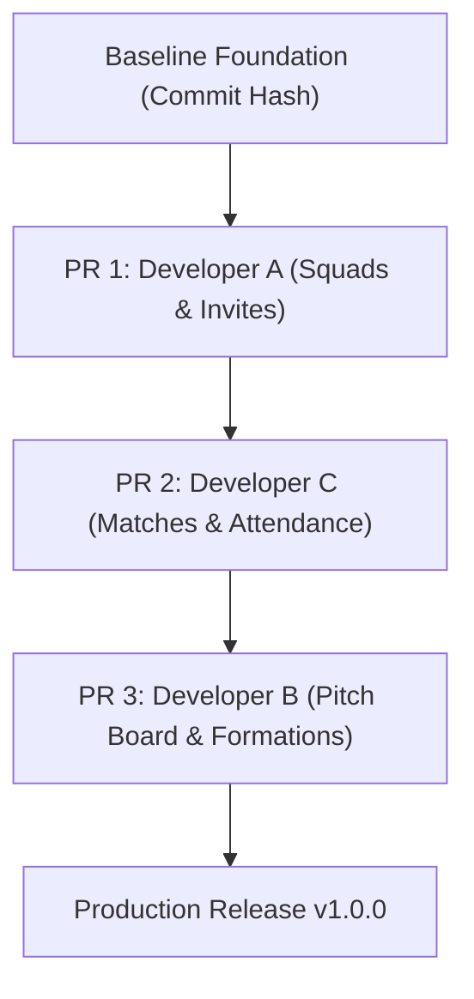

# Turf XI — Integration Checklist & PR Merge Protocol

This runbook guides parallel feature branches into `main` without regressions or schema collisions.

---

## 1. Strict PR Merge Sequence



### Justification for Merge Order:
1. **PR 1 (Developer A):** Establishes squads and member identities. Matches require a valid `squad_id`, so Developer A must merge first.
2. **PR 2 (Developer C):** Establishes scheduled matches and active RSVPs (`playing`). Team generation and player assignment require an existing match and players who are attending.
3. **PR 3 (Developer B):** Places attending players onto teams and pitch coordinates on top of the established match fixtures.

---

## 2. Automated Quality Gates (Must pass before every merge)

Every PR must pass all 4 checks:
```bash
npm run typecheck    # Must pass with 0 errors across landing and web
npm run test         # Must pass all unit and contract test suites
npm run lint         # Must pass with 0 errors and 0 warnings
npm run build        # Must generate SSG landing and Vite production bundles
```

---

## 3. Rapid Acceptance Test Script (Manual Smoke Test)

### Step 1: Landing Page & Deep Linking
1. Open Landing at `http://localhost:3000`.
2. Verify Turf XI hero tagline: *"Create Your Squad. Build Your XI. Own the Turf."*
3. Verify CSS football pitch preview on the landing page features section.
4. Click "Get Started" CTA and verify seamless redirect to Web App `/dashboard` (or `/login` if unauthenticated).

### Step 2: Squad Creation & Room Codes (Developer A)
1. Sign in via Google OAuth or local test session.
2. Navigate to `/squads/new`. Enter squad name (e.g., *"Cochin Strikers"*) and submit.
3. Verify redirected to `/squads/:squadId`.
4. Click "Copy Code" button and verify 6-character room code copied.
5. In an incognito tab with another account, visit `/join`, enter room code, and verify joined as pending/active player.

### Step 3: Match Scheduling & Attendance RSVP (Developer C)
1. In the squad hub, click "Schedule Match".
2. Fill fixture: Title *"Friday Night 7s"*, Turf *"United Turf Arena, Edappally"*, Mode *"Two-Team Friendly Derby"*, Players per team *7*.
3. Submit and verify match created at `/matches/:matchId`.
4. Click RSVP buttons: `Playing`, `Maybe`, `Out`. Verify live attendee counter updates immediately via Supabase RPC `set_attendance`.

### Step 4: Lineup Board & Tactical Pitch (Developer B)
1. On the match detail page, click "Open Pitch Lineup Board".
2. Verify emerald turf pitch board renders with penalty boxes, center circle, and goal areas.
3. Toggle formation preset between `2-3-1` and `3-2-1`. Verify player tokens snap to their normalized pitch coordinates `[0,1]`.
4. Click "Save Formation". Verify optimistic revision increment in database.
5. In a second browser tab, verify pitch board updates in real time without refreshing the page.
